<div align="center">


# House Mix

### Know your crowd before the doors open.

**AI agents that program the whole night (the music, the openers, the food, the sponsors) for the crowd that's actually coming, with every pick backed by a live Qloo taste call.**

[](https://house-mix.vercel.app)
[-0a0a0a?style=for-the-badge&logo=youtube&logoColor=white)](https://youtu.be/Gbt9bEk-PNs)


[](https://github.com/Prashant-thakur77/house-mix/releases)


Built for the **Qloo Agentic Hackathon** with **Qloo Taste AI** (`qloo mcp`) and **Claude** (Claude Agent SDK).
No sign-in: open a show and check every receipt. To plan your own night, add your own Anthropic API key in the top bar.

[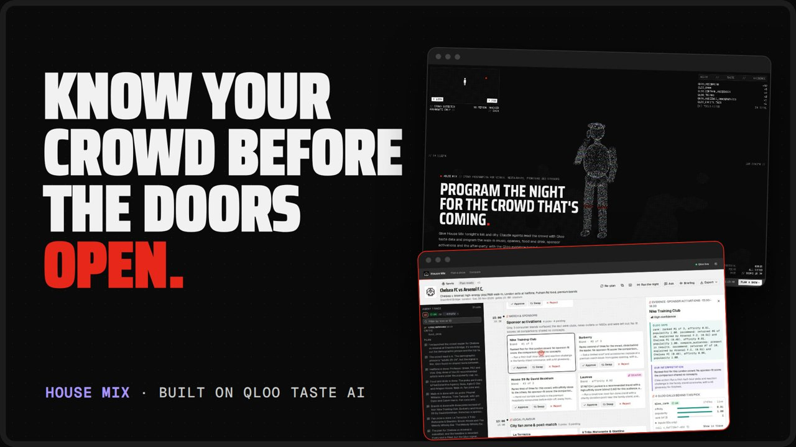](https://youtu.be/Gbt9bEk-PNs)

</div>

---

## At a glance

| | | |
| :---: | :---: | :---: |
| **182 / 182**<br>picks backed by a real Qloo call | **0 / 32**<br>sponsors repeated across 7 shows | **0 / 28**<br>openers bigger than the headliner |
| **10 / 10**<br>Qloo tools, verified on the live API | **26%**<br>of Qloo's top 10 stays when a show moves city | **85%**<br>of picks carry Qloo's own reason |
| **5**<br>kinds of night: concert, comedy, sports, festival, dining | **55 / 59**<br>Qloo-picked artists with real songs to play | **729 min**<br>of timed playlists across 5 demo shows |

Every number on this page comes from scripts in [`eval/`](eval) run against **live Qloo** on 30 Oct 2026, or from the five demo shows planned on live Qloo the same day. Nothing is measured on mock data.

## The problem

Every night, someone at a venue decides the walk-in music, the opener, the halftime act, which food stalls go on the concourse and which sponsor runs the interval activation. They decide for a crowd they have never met, usually from last month's spreadsheet. A psych-funk crowd at the Hollywood Bowl is not a stand-up crowd at The Comedy Store, and Chelsea vs Arsenal is two crowds at once.

**House Mix asks Qloo who is really coming, and a team of Claude agents programs the whole night for them.**

<p align="center">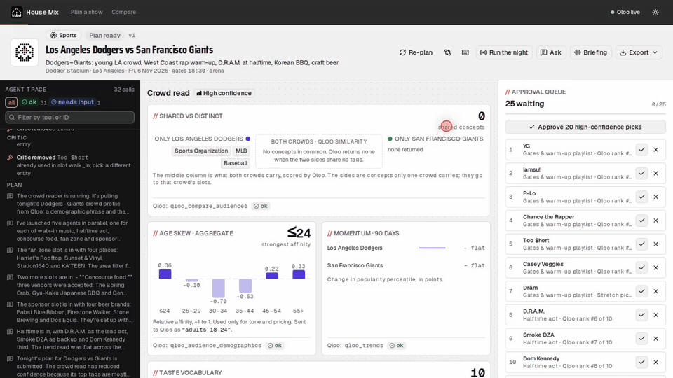<br><sub>A real plan on live Qloo: the agents at work and every Qloo call streaming into the trace (sped up 30×).</sub></p>

## From the bill to the last cue

<table>
<tr>
<td width="50%" valign="top">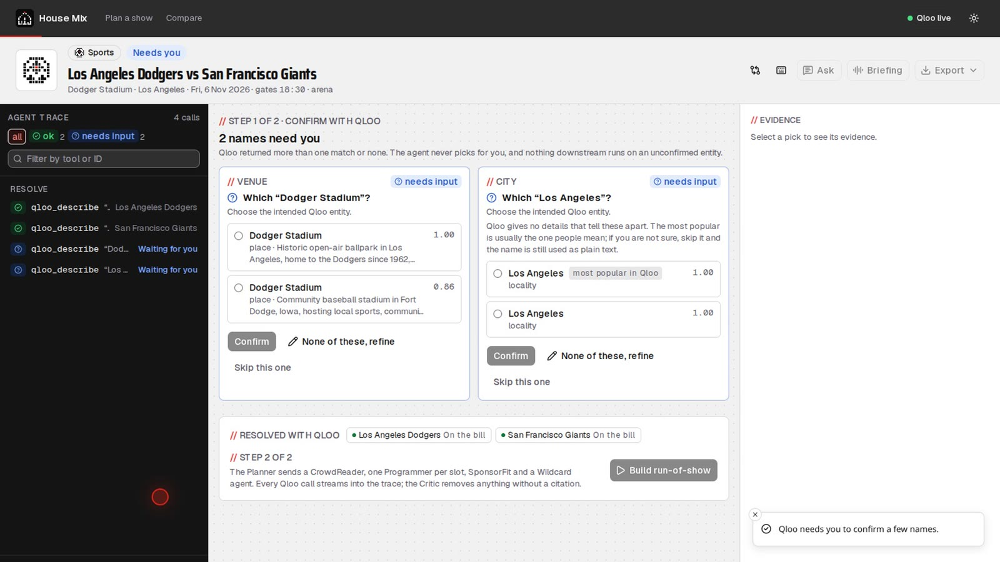<br><b>1 · Every name confirmed.</b> Acts, teams, venues and cities resolve to Qloo IDs. Ambiguous names become a one-click confirm card: Dodger Stadium has a twin in Iowa, so House Mix asks instead of guessing.</td>
<td width="50%" valign="top">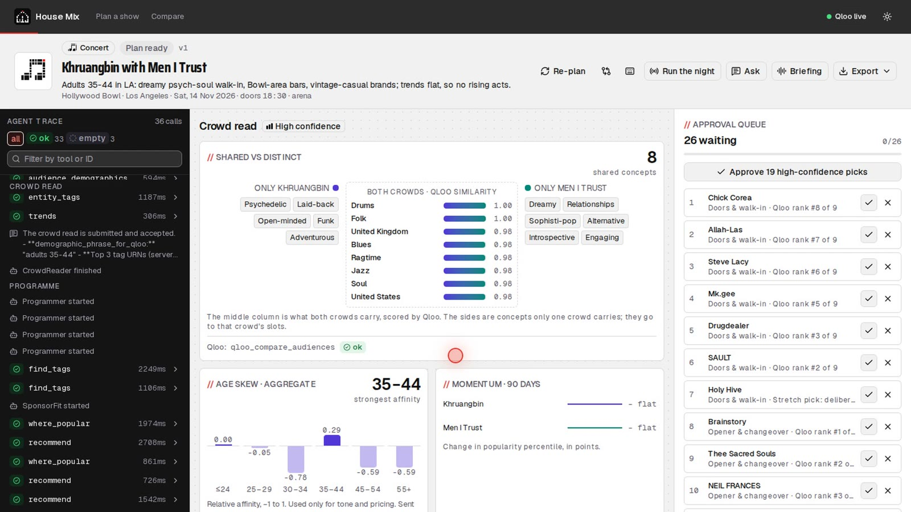<br><b>2 · The crowd read.</b> What both fan bases share, what only one side carries, the age skew, the taste vocabulary and the momentum, straight from Qloo.</td>
</tr>
<tr>
<td width="50%" valign="top">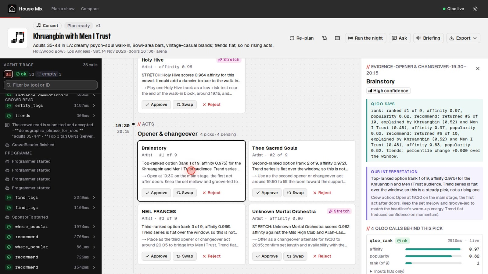<br><b>3 · Every pick with its receipts.</b> Open any pick: exactly what Qloo returned, our reading of it, and which act drove it (“explained by Khruangbin (0.52) and Men I Trust (0.48)”).</td>
<td width="50%" valign="top">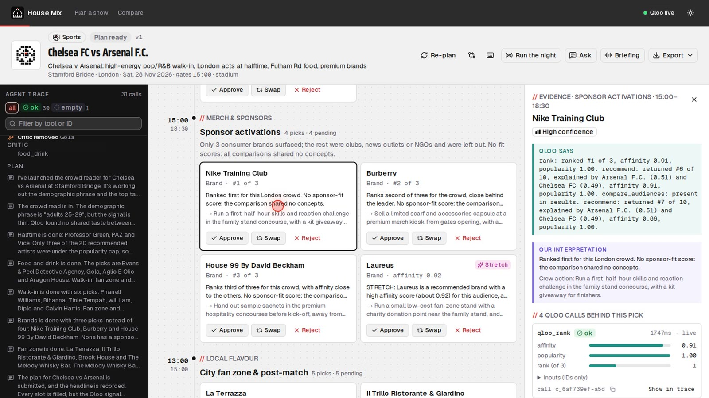<br><b>4 · Sponsors who fit this crowd.</b> Brands Qloo ranks for this exact crowd in this city, an honest crowd-vs-brand comparison, a concrete activation and a one-pager PDF for the sponsor.</td>
</tr>
<tr>
<td width="50%" valign="top">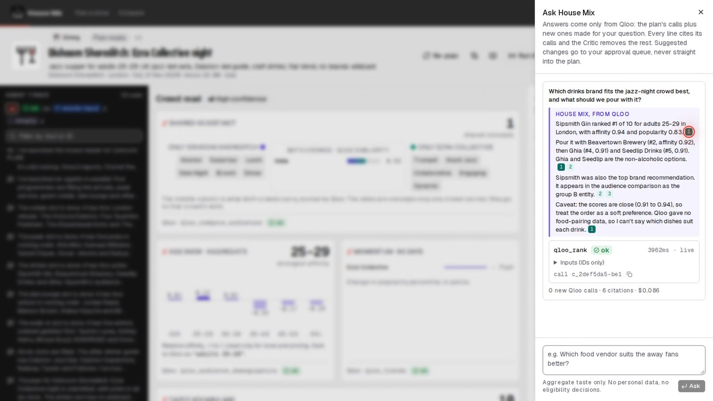<br><b>5 · Ask anything.</b> “Which drinks brand fits the jazz-night crowd?” Answered only from Qloo, every line cited, suggestions routed to the approval queue.</td>
<td width="50%" valign="top">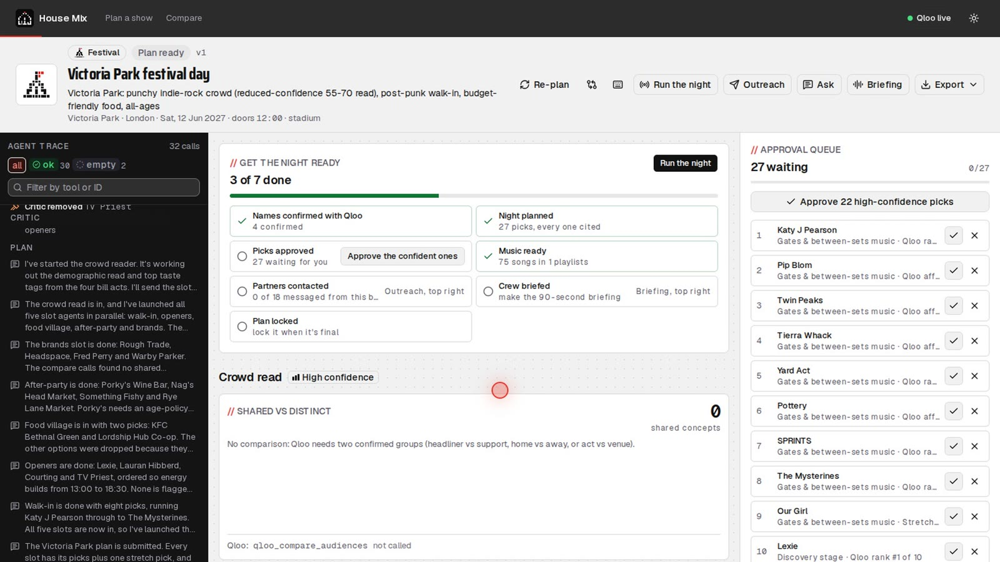<br><b>6 · Get the night ready.</b> One checklist from confirmed names to a locked plan, with the action that moves each step on.</td>
</tr>
<tr>
<td width="50%" valign="top">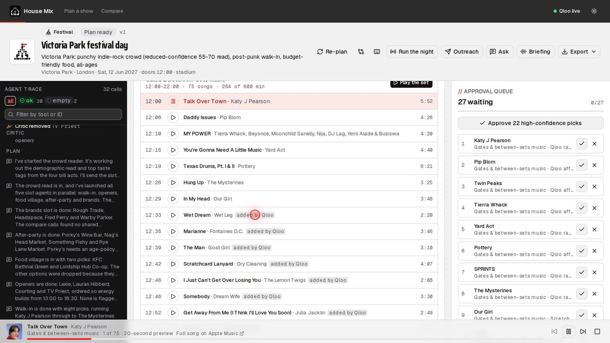<br><b>7 · Hear the night.</b> Every artist Qloo picked becomes real songs in playlists timed to each slot, with 30-second previews. When a set runs short, the agent goes back to Qloo for more artists like that slot's picks and keeps the call as evidence.</td>
<td width="50%" valign="top">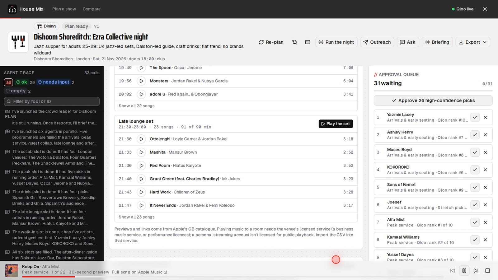<br><b>8 · Music for the whole service.</b> A restaurant gets arrivals, peak service and a late lounge set, each timed to the floor.</td>
</tr>
<tr>
<td width="50%" valign="top">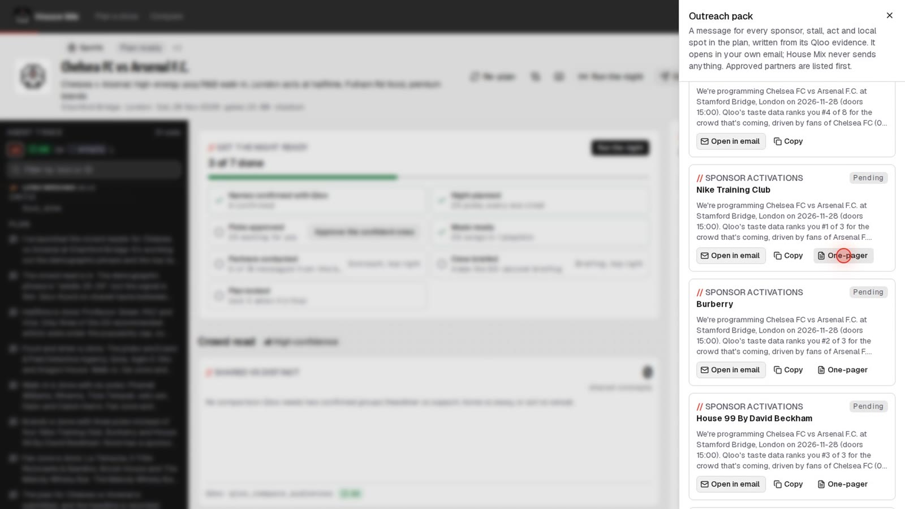<br><b>9 · Hand it off.</b> A ready-to-send message for every partner, written from its Qloo evidence; a cue sheet PDF for the sound desk; playlist CSV and M3U for the venue's licensed music service; a run-of-show PDF.</td>
<td width="50%" valign="top">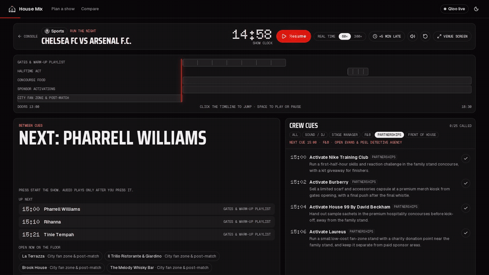<br><b>10 · Run the night.</b> A show clock with the real song playing for whoever is on, and every crew cue on time, re-timed when the night runs late.</td>
</tr>
</table>

## Real nights, planned on live Qloo

Five demo shows, each planned end to end on the live Qloo API: **138 picks**, **291 Qloo calls** across 9 tools, every pick cited. Open any of them on the [live site](https://house-mix.vercel.app).

| Night | Where | A few of Qloo's picks |
| --- | --- | --- |
| 🎸 **Khruangbin with Men I Trust** | Hollywood Bowl, Los Angeles | Opener **Brainstory**, **Thee Sacred Souls**; walk-in **Allah-Las**, **Steve Lacy**; merch with **Herschel Supply Co** and **VSCO** |
| 🎤 **Taylor Tomlinson with Atsuko Okatsuka** | The Comedy Store, Los Angeles | Openers **Fahim Anwar**, **Annie Lederman**; interval podcasts **Bad Friends**, **Sincerely Fortune**; sponsor **Hinge** |
| ⚽ **Chelsea FC vs Arsenal F.C.** | Stamford Bridge, London | Halftime **Professor Green**; warm-up **Pharrell Williams**, **Tinie Tempah**; sponsors **Nike Training Club**, **Burberry**, **House 99 by David Beckham** |
| 🎪 **Victoria Park festival day** | Victoria Park, London | Discovery stage **Lexie**, **Courting**; brand village **Rough Trade**, **Fred Perry**; 8 artists added by Qloo to fill the between-sets music |
| 🍽️ **Dishoom Shoreditch: Ezra Collective night** | Dishoom Shoreditch, London | Peak service **Alfa Mist**, **Yussef Dayes**; drinks partner **Sipsmith Gin**; late lounge **Jordan Rakei**, **Hiatus Kaiyote** |

<table>
<tr>
<td>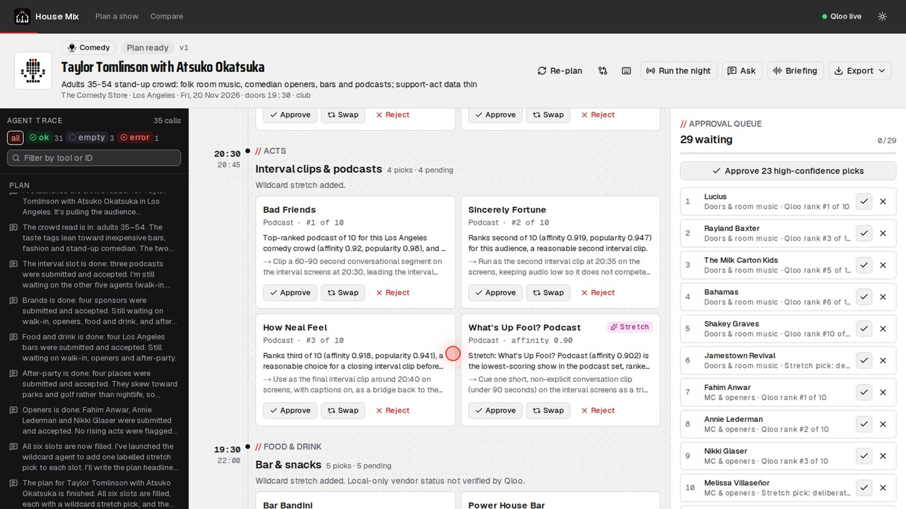<br><sub>Comedy: openers who fit the headliner's crowd, podcasts for the interval</sub></td>
<td>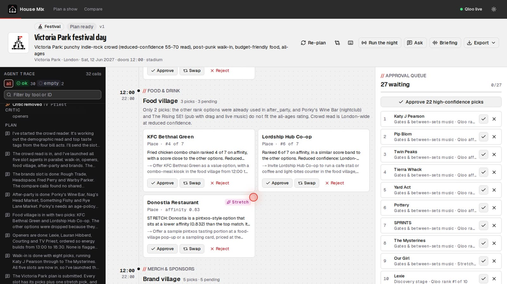<br><sub>Festival: every stage programmed for the crowd moving between them</sub></td>
<td>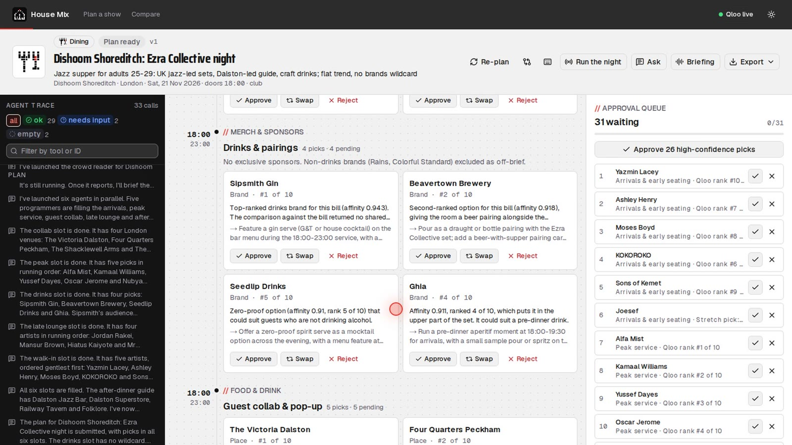<br><sub>Dining: the playlist, the drinks partner, the late lounge set</sub></td>
</tr>
</table>

## Why Qloo makes the difference

We planned **7 real shows** twice on live Qloo: once with House Mix, once with the same Claude model, the same brief and no Qloo ("Claude alone"). Then we checked every pick.

<picture>
  <source media="(prefers-color-scheme: dark)" srcset="docs/img/chart-mistakes-dark.svg">
  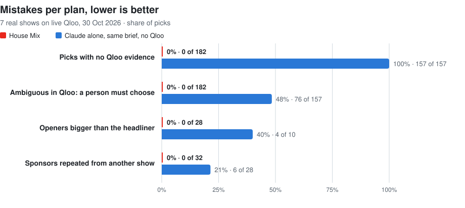
</picture>

| What we checked | House Mix | Claude alone |
| --- | --- | --- |
| Picks backed by a real Qloo call (the call exists and contains the pick) | ✅ **182 of 182** | 0 of 157 |
| Picks that resolve to one confirmed entity | ✅ **all 182** | 76 of 157 (48%) ambiguous in Qloo |
| Sponsors tailored to each crowd (repeats across 7 shows) | ✅ **0 of 32** repeated | 6 of 28 repeated; Spotify pitched to 4 shows |
| Openers, interval and halftime acts smaller than the headliner | ✅ **0 of 28** too big | 4 of 10 too big |
| Qloo's own reason on the card (which input signals drove the pick) | ✅ **155 of 182** (85%) | – |
| Different crowds get different nights (overlap between two crowds' top 10s) | ✅ **0%** across 28 pairs | – |
| Same Qloo call asked twice, cache bypassed | ✅ **5 of 5** identical | – |

**Qloo plans for where the show is, not only who is on the bill.** Ask for the same bill in a city on another continent and, on average, only 26% of Qloo's top 10 stays; all 8 lists changed.

<picture>
  <source media="(prefers-color-scheme: dark)" srcset="docs/img/chart-location-dark.svg">
  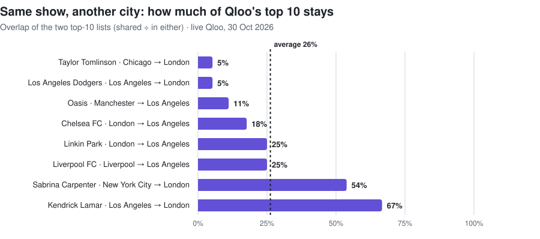
</picture>

### House Mix vs planning by hand or with a chatbot

| | House Mix | A spreadsheet | A general chatbot |
| --- | :---: | :---: | :---: |
| Picks drawn from real taste data for this crowd and city | ✅ | – | – |
| A receipt on every pick, re-checkable by call ID | ✅ | – | – |
| Ambiguous names confirmed before anything runs | ✅ | – | – |
| Sponsors ranked for this crowd, with an honest fit comparison | ✅ | – | – |
| Booking rules enforced (openers under the headliner, places near the venue) | ✅ | – | – |
| Real songs, timed playlists, cue sheet, outreach, run-of-show PDF | ✅ | partly, by hand | – |
| A live show clock with every crew cue | ✅ | – | – |
| Five kinds of night from one tool | ✅ | – | – |

Full methods, every run and the raw results: [`eval/REPORT.md`](eval/REPORT.md) and [`eval/results/`](eval/results).

## Try it with your own key

The five demo shows, the evidence, Hear the night, the exports and Run the night are free for everyone and need nothing. The features that call Claude (planning a new show, Ask House Mix, Without Qloo and the crew briefing) run on **your own Anthropic API key**: click **Your API key** in the top bar and paste it.

- **Kept in your browser only.** The key is sent, in one header, only with those Claude requests. The API uses it for that request's work and never stores, logs or returns it.
- **You pay only for what you use:** about half a dollar for a plan, up to about 25 cents for a question. The public deployment carries no Anthropic key of its own, so nobody can spend anyone else's.
- **Demo shows stay the same for everyone.** Click **Make my own copy** on any demo show to approve, swap, ask and re-plan your own version.
- **A key that doesn't work is reported plainly** ("Anthropic didn't accept that API key", "out of credit"), and a failed plan never replaces the one you have.

## How it uses Qloo

All **10 tools** of `qloo mcp` do load-bearing work. The backend starts `qloo mcp` as a stdio MCP server and routes every call through one client ([`apps/api/src/qloo/client.ts`](apps/api/src/qloo/client.ts)) with a 24-hour cache keyed by the SHA-256 of the arguments, retries only when Qloo says an error is retryable, a 40-call budget per plan, a personal-data guard, and a ledger entry for every call.

| Tool | What it powers in House Mix |
| --- | --- |
| `qloo_capabilities` | Readiness at boot and the "Qloo live" badge |
| `qloo_find_tags` | Turns the operator's vibe words into Qloo tags |
| `qloo_describe` | Turns every name into a confirmed ID, so every later call is exact |
| `qloo_compare_audiences` | Home vs away, headliner vs support, act vs venue; crowd vs brand for sponsor fit; tonight vs last night |
| `qloo_audience_demographics` | Aggregate age skew for tone and pricing |
| `qloo_entity_tags` | The crowd's taste vocabulary |
| `qloo_recommend` | Candidates for every slot, the wildcard, and filling a short playlist |
| `qloo_rank` | Orders every shortlist (including the venue's own local acts) and powers swap |
| `qloo_where_popular` | Food, drink, after-party spots and street-team areas near the venue |
| `qloo_trends` | Rising flags on acts and the momentum chart |

<picture>
  <source media="(prefers-color-scheme: dark)" srcset="docs/img/chart-latency-dark.svg">
  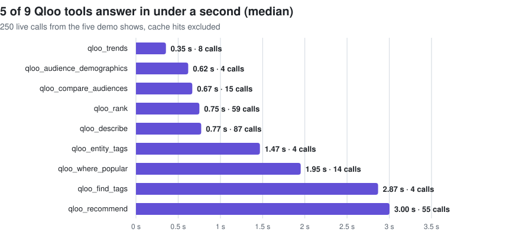
</picture>

**Evidence that can't be faked.** Agents submit picks as `{entity_id, call_id}` pairs. A hook rejects any pick whose call isn't in the run's ledger or doesn't contain the pick, and the server builds each pick's evidence from the ledger itself: tool, inputs, status, scores and Qloo's explanation. A Claude claim check then trims any sentence the evidence doesn't support.

**Built against the live API.** `npm run qloo:verify` diffs every live response shape against our adapters and records fixtures ([`docs/QLOO_VERIFY.md`](docs/QLOO_VERIFY.md)): 10 of 10 tools and 11 of 11 checks pass. House Mix reads Qloo's three-list audience comparison, its explainability on every recommendation, and its trend window, and confirms ambiguous names ("London" has four Qloo localities) with the operator. [`docs/QLOO_WALKTHROUGH.md`](docs/QLOO_WALKTHROUGH.md) traces one show from request to result.

## Architecture


| Layer | What runs there |
| --- | --- |
| **Agents** | Claude Agent SDK: a planner, a crowd reader, one programmer per slot in parallel, sponsor fit and a wildcard; the Anthropic SDK for Ask House Mix, the Critic and the crew briefing |
| **Qloo** | `qloo mcp` over stdio, all 10 tools, one client with cache, budget, guard and ledger |
| **API** | Fastify on Cloud Run, Firestore, Cloud Storage, Cloud Text-to-Speech; react-pdf for every PDF |
| **Web** | Next.js 16 on Vercel, shadcn/ui, Tailwind v4, Recharts, Web Audio for Run the night |

## How it's tested

| Layer | Count | What it checks |
| --- | :---: | --- |
| **Live contract** | **11 / 11** checks · **10 / 10** tools | Every Qloo tool against the live API; every adapter reads the live shapes (`npm run qloo:verify`) |
| **Unit and API** | **43** passing | Adapters on recorded live Qloo responses, the evidence gate, the music builder and its Qloo fill loop, bring-your-own-key and read-only demo shows, eval maths, and the API over a real MCP connection (`npm test`) |
| **End to end** | **45** passing, in mock mode **and** against live Qloo | Every flow in a real browser: intake and confirm cards, the plan console, exports, Ask, Hear the night (a real preview plays), outreach, readiness and Run the night (`npm run test:e2e`) |
| **Accessibility** | WCAG 2.1 AA | axe-core on every page, desktop and mobile, light and dark |
| **Evaluation** | 7 real shows · 14 plans · 339 picks checked | Citations, ambiguity, booking realism, crowd specificity, location, repeatability and explainability on live Qloo ([`eval/REPORT.md`](eval/REPORT.md)) |
| **Production** | after every deploy | The hosted site loads, shows "Qloo live", reaches the API and plays a real preview |

## Run it yourself

Requirements: Node.js 22.19 or newer and an Anthropic API key. A Qloo key is optional: without one, a schema-identical mock runs and every screen says **MOCK DATA**.

```sh
git clone https://github.com/Prashant-thakur77/house-mix && cd house-mix
npm install
cp .env.example .env.local          # set ANTHROPIC_API_KEY (and QLOO_API_KEY for live Qloo)
npm run dev:api                     # API on :8787, seeds load automatically
npm run dev:web                     # console on :3000
```

Live Qloo:

```sh
npm install --global @qloo/qloo-harness   # 0.1.26 or newer
npm run qloo:verify                       # checks every live shape and records fixtures
QLOO_MODE=live npx tsx --env-file=.env.local apps/api/scripts/seed.ts
npm run eval:qloo                         # the free Qloo checks above
```

Tests: `npm run typecheck && npm test && npm run test:e2e`. Deploy: `infra/deploy-api.sh` (Cloud Run) and `infra/deploy-web.sh` (Vercel); see [`docs/GO_LIVE.md`](docs/GO_LIVE.md).

## Repository

| Path | What it holds |
| --- | --- |
| [`apps/api`](apps/api) | Fastify API, Qloo client and mock server, the agent pipeline, Critic, music, briefing and exports |
| [`apps/web`](apps/web) | The Next.js console, Run the night and the landing page |
| [`packages/shared`](packages/shared) | Zod schemas, mode templates, guardrails |
| [`eval`](eval) | The evaluation kit, the free Qloo checks and the report generator |
| [`fixtures`](fixtures) | The five live demo shows, mock fixtures and live Qloo fixtures |
| [`video`](video) | The film, built from code: recordings, narration, drawn scenes and the edit |
| [`docs`](docs) | Qloo contract and walkthrough, Devpost write-up, go-live steps, [scope notes](docs/LIMITATIONS.md) |

Charts on this page: `python3 docs/charts.py` redraws them from `eval/results/`.

## Releases

**v1.0.0** is the hackathon release. Every version since the first commit is tagged, with notes: see [`CHANGELOG.md`](CHANGELOG.md) and [Releases](https://github.com/Prashant-thakur77/house-mix/releases). The live API reports its version at [`/health`](https://house-mix-api-120659974854.us-central1.run.app/health).

## Licence

MIT. See [LICENSE](LICENSE).
