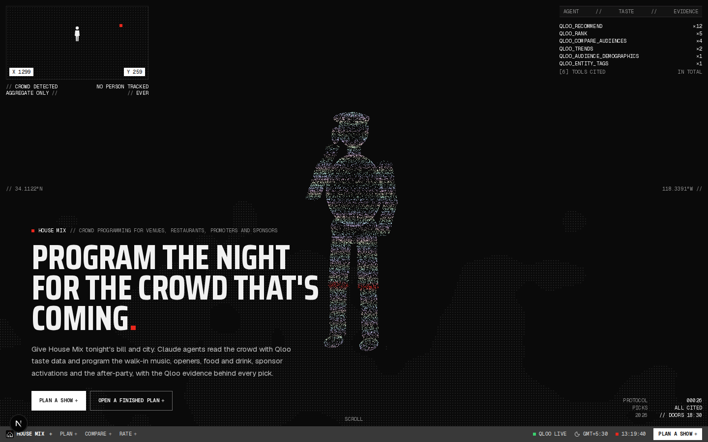
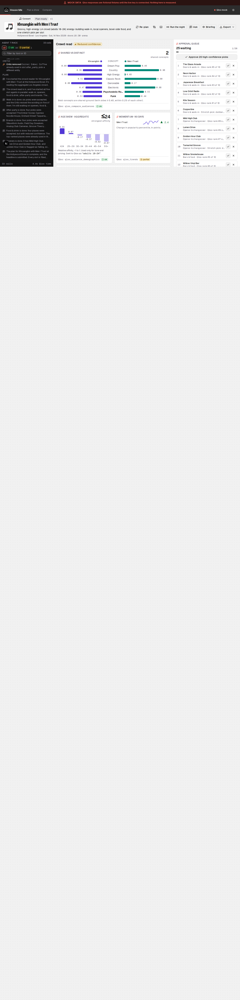
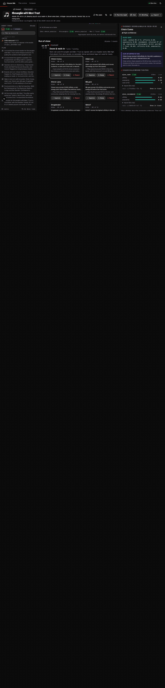
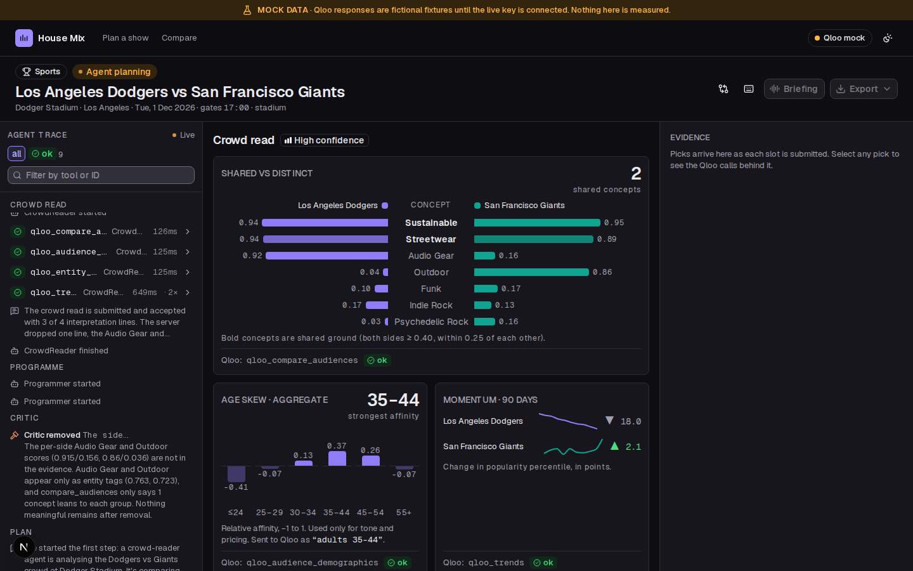
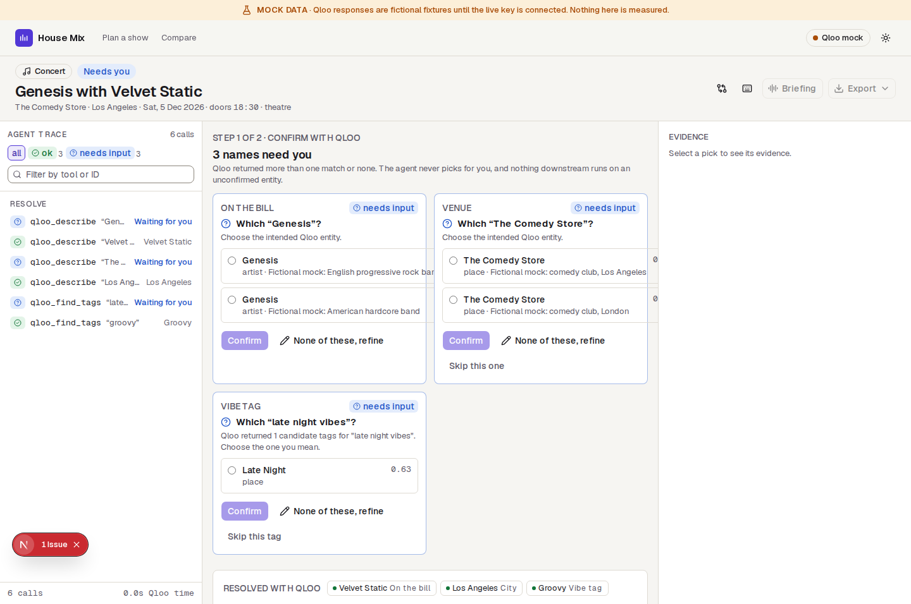
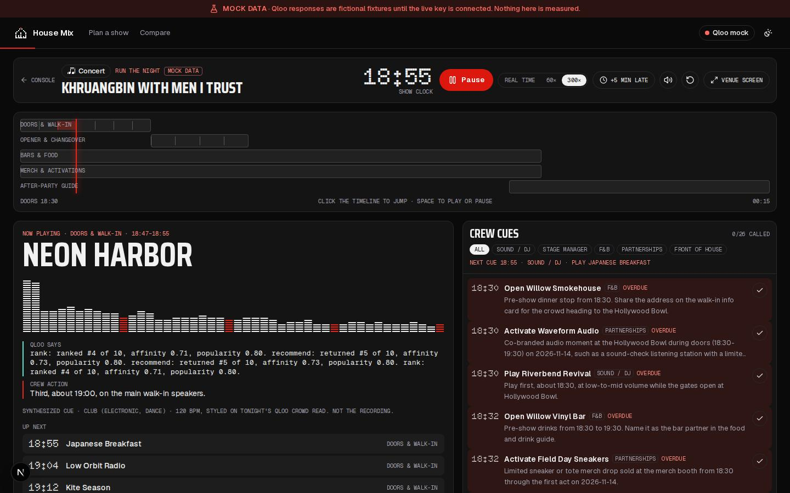
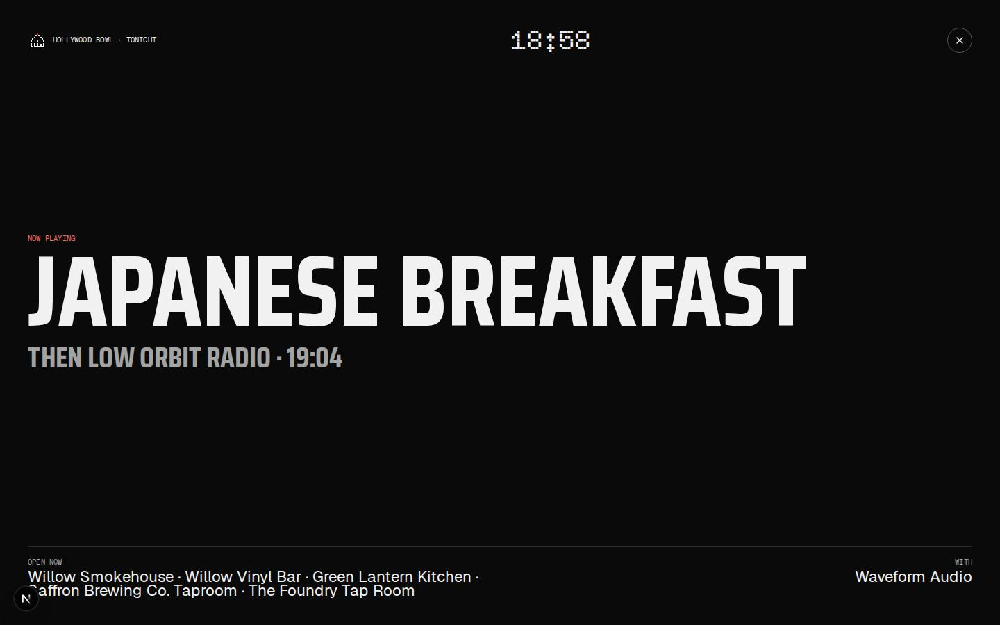
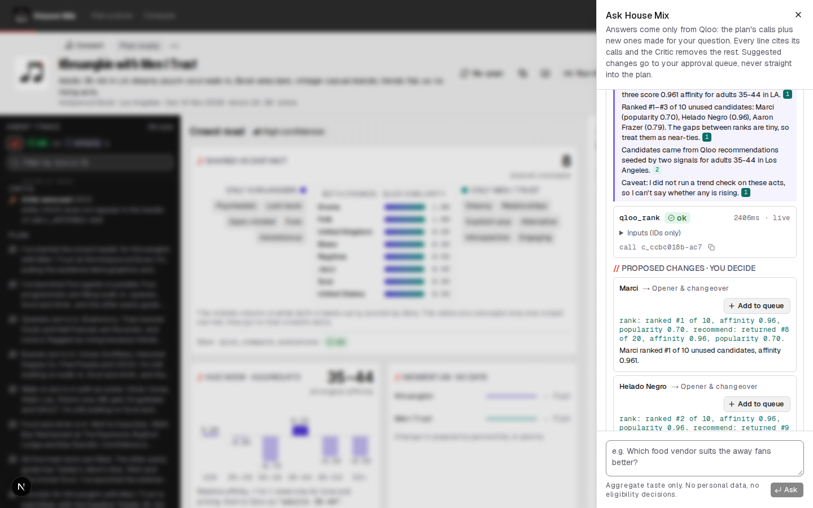
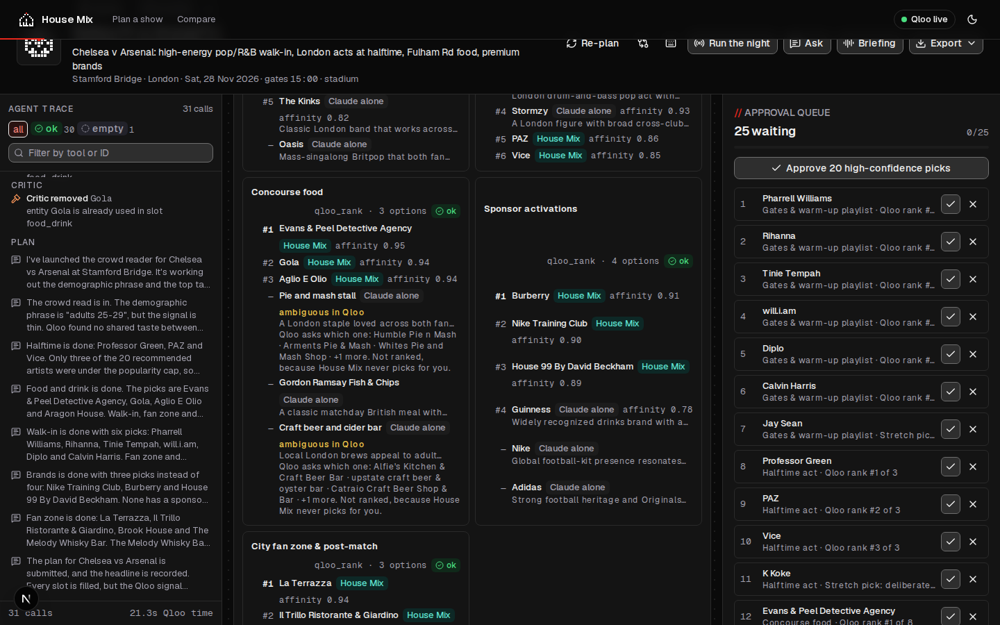
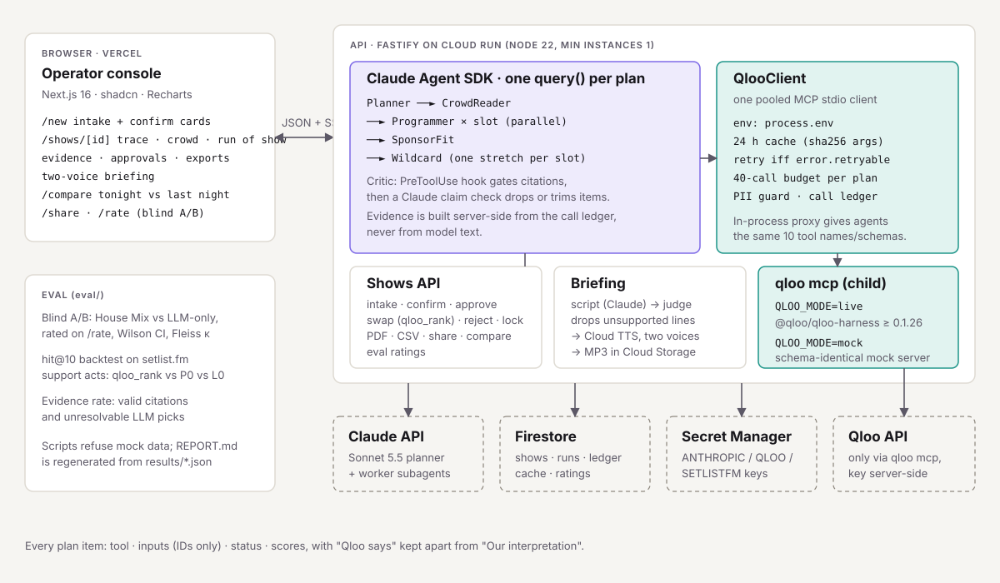

# House Mix

**House Mix turns tonight's lineup into a run-of-show programmed for the crowd you actually have.** A venue GM or promoter enters the event (headliner and support, or home vs away) and the city. A team of Claude agents uses Qloo taste data to pick the walk-in playlist, openers and interval acts, food and drink partners, merch and sponsor activations, and a local guide, plus one labelled "stretch" pick per slot. Every pick carries its evidence. The operator approves, swaps or rejects each line, locks a version, exports it and plays a two-voice briefing to the crew.

Built for the Qloo Agentic Hackathon ("Agents, but with taste"). Four modes: **Concert, Comedy, Sports, Festival**.

**Live demo (no login):** https://house-mix.vercel.app · API: https://house-mix-api-120659974854.us-central1.run.app/health

Open a seeded show (concert, comedy night, football fixture, festival day) to see a full plan instantly, or plan a new one. Until the live Qloo key is connected the demo runs on the schema-identical mock and says **MOCK DATA** on every screen.



| Console: live trace, crowd read, approval queue | Evidence drawer: "Qloo says" vs "Our interpretation" |
| --- | --- |
|  |  |
|  |  |
| Run the night: show clock, now playing with a synthesized cue, crew cues by role | The venue screen |
|  |  |
| Ask House Mix: cited answer, Critic, proposals into the queue | Without Qloo: Claude-alone picks checked and ranked by Qloo |
|  |  |



## What it does

| Step | What happens | Qloo tools |
| --- | --- | --- |
| Intake | Event, bill, venue, city, date, capacity, house rules (budget, age rating, exclusive sponsors, local-only vendors, vibe words, local acts) | – |
| Resolve and confirm | Every name is resolved to a Qloo ID. Anything ambiguous (try "Genesis") becomes a confirm card. Nothing is auto-picked, and nothing downstream runs on an unconfirmed entity. | `qloo_describe`, `qloo_find_tags` |
| Crowd read | Shared vs distinct taste between the two sides (or the act vs the venue), aggregate age skew, taste vocabulary, 90-day momentum | `qloo_compare_audiences`, `qloo_audience_demographics`, `qloo_entity_tags`, `qloo_trends` |
| Run of show | One Programmer agent per slot, each following its own Qloo chain; SponsorFit scores brands against the crowd; Wildcard adds one adjacent stretch pick per slot | `qloo_recommend`, `qloo_rank`, `qloo_where_popular`, `qloo_trends`, `qloo_compare_audiences` |
| Critic | A PreToolUse hook rejects any submission whose citations don't check out; a Claude claim check removes or trims unsupported statements | (ledger) |
| Approvals | Approve, swap (re-ranks the slot's remaining alternatives with a fresh `qloo_rank`), reject with a reason (a negative signal for the next plan), lock with version + timestamp | `qloo_rank` |
| Exports | Run-of-show PDF, ops CSV, read-only share link, sponsor one-pager PDF per brand | – |
| Briefing | ~90 s two-voice script; an evidence judge drops any line it cannot support; Cloud TTS voices it (device voices as a fallback) | (evidence) |
| Crowd map | Where each side's taste concentrates in the show city, the areas that are strong for every side, and the top three for street teams and flyering (tile-free SVG with a table view) | `qloo_where_popular` |
| Without Qloo | Claude plans the same brief with no tools; Qloo looks up every one of those picks by name and ranks both plans' top picks per slot for tonight's crowd. Ambiguous names are reported, never auto-picked | `qloo_describe`, `qloo_rank` |
| Ask House Mix | Questions about the plan ("if the support act cancels, who opens?") answered by a tool-using Claude loop over the real Qloo tools. Every line cites call IDs, the Critic removes the rest, and suggested changes go to the approval queue as pending items | all nine query tools |
| Run the night | The plan played out on a show clock (real time, 60× or 300×): a timeline with a playhead, "now playing / on stage" with a synthesized audio cue styled on the crowd's Qloo tags, up next, a crew cue sheet by role (sound, stage, F&B, partnerships, front of house) that can be called and re-timed ("+5 min late"), and a full-screen venue display | (plan evidence) |
| Compare | Tonight vs last night: one comparison across the two bills plus a plan diff | `qloo_compare_audiences` |
| Health | Readiness badge and the MOCK DATA banner | `qloo_capabilities` |

## Qloo usage

All 10 tools of `qloo mcp` do load-bearing work. The backend starts `qloo mcp` as a stdio MCP server with `env: process.env` and routes every call through one client (`apps/api/src/qloo/client.ts`). That client applies a 24-hour cache keyed by the SHA-256 of the canonical arguments, retries **only** when `error.retryable` is true (at most twice), enforces a 40-call budget per plan, blocks personal data before it is sent, and records a ledger entry per call. The agents see the same tool names and JSON schemas through an in-process proxy (`apps/api/src/agent/tools.ts`).

| Tool | Where | Inputs we send | What breaks without it |
| --- | --- | --- | --- |
| `qloo_capabilities` | Boot and the health badge | `{}` | No readiness check; the UI can't warn about a missing key |
| `qloo_find_tags` | Intake vibe words | `query`, `limit` | Free-text vibes can't become tag URNs |
| `qloo_describe` | Intake names; confirming a choice by ID; checking "Without Qloo" picks | `entity`, `type` | No confirmed IDs; every later call would hit `needs_input`; no way to tell which knowledge-only picks Qloo even knows |
| `qloo_compare_audiences` | Crowd read; sponsor fit; compare page | `group_a`, `group_b` (IDs), `target_type`, `limit` | No home-vs-away split, no sponsor-fit score |
| `qloo_audience_demographics` | Crowd read (aggregate only) | `entity`, `entity_type` | No age skew; no demographic phrase for ranking |
| `qloo_entity_tags` | Crowd vocabulary | `entities`, `entity_type` | No "why" vocabulary for the crowd |
| `qloo_recommend` | Every slot's candidates; wildcards | `target_type`, `signals` (IDs), `signal_tags` (URNs), `signal_location`, `filter_location`, `exclude_tags` | No candidates beyond what the operator already knows |
| `qloo_rank` | Ordering each slot; local acts; swap; ranking House Mix vs Claude-alone picks | `options` (≤10 IDs), `option_type`, `signals`, `signal_location`, `demographic` | Shortlists stay unordered; swap has nothing to re-rank with |
| `qloo_where_popular` | Food & drink and local guide; the crowd map (one call per side) | `entity`, `entity_type`, `within` (city), `limit` | The plan isn't specific to the city; no street-team areas |
| `qloo_trends` | Rising flags on acts; momentum chart | `entities` (1–5), `entity_type`, 90-day `start_date`/`end_date` | No momentum signal for booking risk |

Status handling follows the kit. `ok`: use the results. `empty`: "no Qloo signal", never invented. `needs_input`: a confirm card at intake, and the agents are told never to pick a candidate. `partial`/`degraded`: used with a "reduced confidence" chip and the summary. `error`: retried only when retryable; otherwise the recovery text is shown and the slot is marked "needs manual input". The demographic phrase sent back to Qloo is derived from Qloo's own age distribution, and it is age-only.

`docs/QLOO_CONTRACT.md` documents the exact runtime contract of `@qloo/qloo-harness` 0.1.26. `docs/QLOO_WALKTHROUGH.md` is a redacted request-to-result trace for one show.

## Results

All numbers come from scripts in `eval/` that write `eval/results/*.json`; `eval/REPORT.md` is regenerated from them. Metrics are never computed from mock data.

| Claim | House Mix | Baseline | Status |
| --- | --- | --- | --- |
| Blind A/B preference vs LLM-only (same model, no Qloo) | pending | L0 | Needs the live Qloo key and human raters |
| Real support act in top 10 of a 50-artist pool (hit@10) | pending | Popularity (P0), LLM-only (L0) | Needs the live Qloo key and a setlist.fm key |
| Plan items with a valid Qloo citation | pending | L0 has none | Needs live plans |

See [`eval/REPORT.md`](eval/REPORT.md) for methods and the negative result.

## Run it from a clean machine

Requirements: Node.js 22.19 or newer, an Anthropic API key. A Qloo key is optional (the mock runs without it).

```sh
git clone <this repo> house-mix && cd house-mix
npm install
cp .env.example .env.local          # then set ANTHROPIC_API_KEY (and QLOO_API_KEY when you have it)
npm run dev:api                     # API on :8787 (QLOO_MODE=mock by default; seeds load automatically)
npm run dev:web                     # console on :3000
```

Open http://localhost:3000 and pick a seeded show, or plan a new one.

Switch to live Qloo:

```sh
npm install --global @qloo/qloo-harness   # 0.1.26 or newer (qloo:verify installs it locally if missing)
# put QLOO_API_KEY=... in .env.local
npm run qloo:verify                       # diffs live schemas/envelopes against the mock, records fixtures/live, sets QLOO_MODE=live
QLOO_MODE=live npx tsx --env-file=.env.local apps/api/scripts/seed.ts   # live seeds
npm run eval:all                          # needs SETLISTFM_API_KEY for the backtest
```

Tests: `npm run typecheck && npm test` (unit and API tests over a real stdio MCP connection to the mock) and `npm run test:e2e` (Playwright end-to-end plus axe WCAG 2.1 AA, desktop and mobile, light and dark).

Deploy: `infra/secrets.sh`, `infra/deploy-api.sh` (Cloud Run, min instances 1, secrets from Secret Manager, Firestore, Cloud Storage, Text-to-Speech) and `infra/deploy-web.sh` (Vercel).

## Repository

| Path | What it holds |
| --- | --- |
| `apps/api` | Fastify API, Qloo client and mock server, agent pipeline, Critic, briefing, exports |
| `apps/web` | Next.js console |
| `packages/shared` | Zod schemas, mode templates, guardrails, demographic parser |
| `eval` | A/B kit, setlist.fm backtest, evidence rate, report generator |
| `fixtures` | Mock fixtures (fictional), seeded demo shows, live fixtures after `qloo:verify` |
| `design` | Reference screenshots and scores, the design direction, app screenshots |
| `docs` | Contract, walkthrough, Devpost write-up, video script, friction and refine logs |

## Limitations

- Qloo results describe aggregate cultural affinities of audiences. They say nothing about any individual attendee, and an affinity is a relative signal, not a probability that tonight's crowd will like or buy something.
- Scores from separate Qloo calls are not comparable; each ranking only orders the options it was given.
- Coverage is uneven: local acts, small vendors and working comedians can have thin or no Qloo signal. They are labelled, never invented.
- Demographic charts are aggregate distributions, used only for tone and pricing, never to admit, exclude or target anyone. House Mix refuses eligibility-type requests and rejects personal data at intake and before every Qloo call.
- The sponsor-fit number is our formula over Qloo's crowd-vs-brand comparison, not a Qloo score.
- In mock mode every Qloo result is fictional, and the UI says so on every screen.
- "Without Qloo" has Qloo rank House Mix's own picks against Claude-alone picks, so a House Mix lead there is expected and is not an independent quality test. The blind human A/B in `eval/` is the quality test.
- The crowd map shows where an act's taste concentrates by area (Qloo heatmap cells), centred on the returned areas rather than the venue; it is not a map of where attendees live.
- Run the night's audio is synthesized in the browser (Web Audio) in a style chosen from the crowd's Qloo tags; it is never the actual recording, and the page says so.
- Ask House Mix answers only from Qloo calls, so questions Qloo can't speak to (prices, opening hours, walking distance) come back as "check this yourself" rather than a guess.

## Licence

MIT. See [LICENSE](LICENSE).
